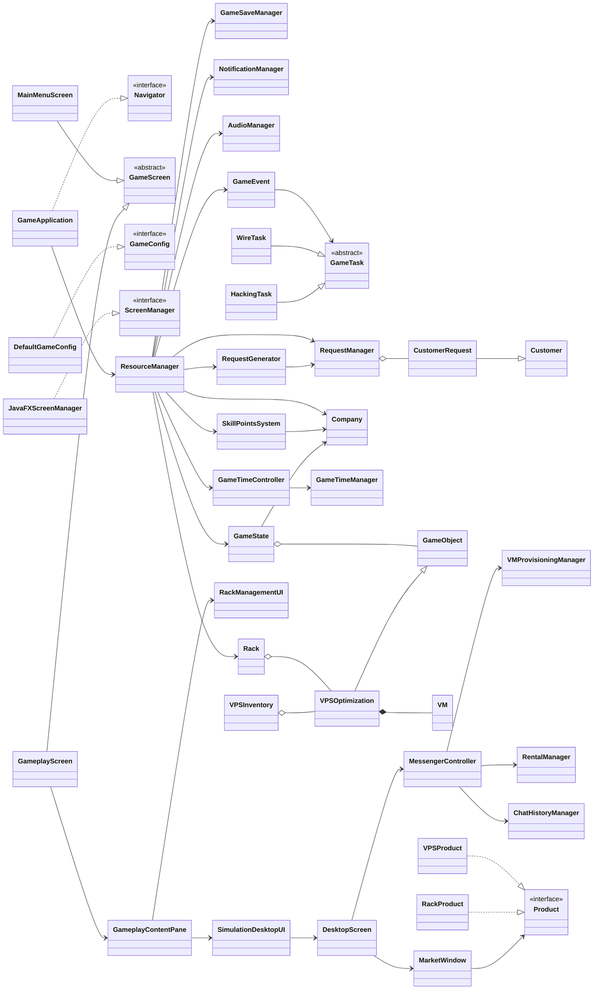

# 🎮 VPS TYCOON

## 📋 สารบัญ (Table of Contents)

- [📖 รายละเอียดโปรเจค (Project Overview)](#project-overview)
- [🎮 รายละเอียดเกม (Game Details)](#game-details)
- [⚙️ การติดตั้ง (Installation)](#installation)
- [🤝 วิธีการมีส่วนร่วม (How to Contribute)](#how-to-contribute)
- [🧩 สถาปัตยกรรม (Architecture)](#architecture)

<a id="project-overview"></a>
## 📖 รายละเอียดโปรเจค (Project Overview)

VPS Tycoon เป็นเกมแนว Tycoon ที่พัฒนาด้วย JavaFX ให้ผู้เล่นได้บริหารธุรกิจ VPS Hosting

### โครงสร้างโปรเจค (Project Structure)

```
com.vpstycoon/
├── application/        - จุดเริ่มโปรแกรม (Bootstrap) และวงจรชีวิตของแอป (GameApplication)
├── audio/              - เล่นเพลงและเสียงเอฟเฟค
├── config/             - การตั้งค่าเกม (ความละเอียดจอ, เสียง) บันทึกเป็น game_config.properties
├── event/              - Event Bus สำหรับส่ง event ระหว่างระบบ
├── screen/             - จัดการหน้าต่างและความละเอียดหน้าจอ
├── model/              - ข้อมูลของเกม (ไม่มีโค้ด UI)
│   ├── company/        - บริษัทของผู้เล่น และระบบ Skill Points
│   ├── customer/       - ลูกค้าและคำขอเช่า VPS
│   ├── chat/           - ข้อความแชทใน Messenger
│   ├── server/         - เซิร์ฟเวอร์, VM, Rack และคลังเซิร์ฟเวอร์
│   └── market/         - สินค้าในร้าน (Product, VPSProduct, RackProduct)
├── manager/            - ตัวจัดการหลักของเกม (ResourceManager, GameManager, RequestManager, VPSManager)
├── thread/             - งานที่รันเบื้องหลัง: นาฬิกาเกม, สร้างคำขอลูกค้า, สุ่ม mini-game
├── persistence/        - บันทึก/โหลดเกม และประวัติแชท
└── ui/
    ├── common/         - ส่วนประกอบ UI ที่ใช้ร่วมกัน (GameScreen, SceneController, ปุ่ม, สไตล์, ฟอนต์, ImageCache)
    ├── menu/           - หน้าเมนูหลัก
    ├── settings/       - หน้าตั้งค่า
    ├── cutscene/       - ฉากเปิดเกม
    ├── debug/          - หน้าต่าง debug (กด F3)
    └── game/           - หน้าจอระหว่างเล่น (GameplayScreen, GameplayContentPane, ResumeScreen)
        ├── room/       - ห้องและวัตถุที่คลิกได้
        ├── input/      - คีย์บอร์ด, ซูม/เลื่อนกล้อง
        ├── hud/        - เงิน, วันที่ และปุ่ม Skill
        ├── notification/ - การแจ้งเตือน 3 แบบ (มุมขวาบน, กลางจอ, ที่เมาส์)
        ├── desktop/    - คอมพิวเตอร์ในเกม และร้านค้า (Market)
        ├── messenger/  - แชทกับลูกค้า และการจัดสรร VM
        ├── rack/       - หน้าจัดการ Rack
        ├── server/     - หน้าจัดการเซิร์ฟเวอร์, VM และคลังเซิร์ฟเวอร์
        └── task/       - mini-game 11 แบบ (สืบทอดจาก GameTask)
```

### เทคโนโลยีที่ใช้ (Technologies)

- **Java 23** - ภาษาหลักที่ใช้พัฒนา
- **JavaFX 23** (controls, media) - สำหรับ UI กราฟิก และเสียง
- **Maven** - เครื่องมือจัดการ dependencies

ข้อมูลเซฟเกมเก็บที่ `~/Documents/VpsTycoon/` (`savegame.dat` และ `save.dat` สำหรับประวัติแชท)

<a id="game-details"></a>
## 🎮 รายละเอียดเกม (Game Details)

### แนวเกม (Game Genre)
เกมแนว Tycoon ที่ให้ผู้เล่นบริหารธุรกิจ VPS Hosting

### เป้าหมายของเกม (Game Goals)
1. **บริหารเซิร์ฟเวอร์**: ซื้อ, อัปเกรด, ดูแลเซิร์ฟเวอร์เพื่อรองรับลูกค้า VPS
2. **จัดการการเงิน**: รักษาสภาพคล่องทางการเงิน และทำกำไร
3. **แก้ปัญหาแบบ Real-time**: เผชิญกับปัญหาสุ่ม เช่น Data Breach, VM Crash
4. **ขยายธุรกิจ**: อัปเกรดห้อง, ติดตั้ง Firewall, Router เพื่อรองรับลูกค้ารายใหญ่

### กลไกหลักของเกม (Core Mechanics)
- **การบริหารทรัพยากร**: วางแผนซื้อ/อัปเกรดเซิร์ฟเวอร์ และจัดการค่าใช้จ่าย
- **การตั้งค่า VPS Plans**: กำหนดแพ็กเกจ VPS ให้เหมาะสมกับตลาด
- **เหตุการณ์สุ่ม (Random Events)**: สร้างความท้าทายให้ผู้เล่น
- **ระบบพัฒนา (Development Points)**: ใช้แต้มเพื่อพัฒนาธุรกิจใน 4 ด้าน
  - 🔴 Deploy: ลดเวลาการ Deploy VPS, ปลดล็อคระบบปฏิบัติการใหม่
  - 🔵 Network: เพิ่ม Bandwidth, ลด Network Congestion
  - 🟣 Security: ลดโอกาส Data Breach, เพิ่มตัวเลือก Firewall
  - 🟢 Marketing: เพิ่มช่องทางการตลาด, เพิ่มโอกาสได้ Rating สูง

### Game Flow
1. **Main Menu**: New game, Continue, Setting, Exit
2. **Gameplay**:
   - เลือกรับคำขอจากลูกค้า
   - Optimize VPS (เลือก OS, Security, Performance Tuning, Backup, Monitoring)
   - จัดการกับ Events ที่เกิดขึ้นระหว่างการให้บริการ
   - สรุปผลการให้บริการ (ได้รับ Points, Rating)
3. **Market**: อัพเกรดอุปกรณ์และบริษัท

<a id="installation"></a>
## ⚙️ การติดตั้ง (Installation)

### ความต้องการระบบ (Requirements)
- Java 23 หรือสูงกว่า
- JavaFX 23
- Maven

### วิธีติดตั้ง (Setup Instructions)

1. **Clone โปรเจค**
```
git clone https://github.com/yourusername/vps-tycoon.git
cd vps-tycoon
```

2. **Build ด้วย Maven**
```
mvn clean package
```

3. **รันเกม**
```
mvn javafx:run
```

### การตั้งค่า Intellij IDEA

สำหรับการใช้งานกับ IntelliJ IDEA กรณีติดตั้ง JavaFX แยก:

1. ไปที่ `Run > Edit Configurations...`
2. กด `Modify options...`
3. ใส่ใน VM options:
```
--module-path "C:\path\to\javafx-sdk-23\lib" --add-modules javafx.controls,javafx.media
```

<a id="how-to-contribute"></a>
## 🤝 วิธีการมีส่วนร่วม (How to Contribute)

1. **Fork โปรเจค**
2. **สร้าง branch ใหม่**
   ```
   git checkout -b feature/your-feature-name
   ```
3. **Commit การเปลี่ยนแปลง**
   ```
   git commit -m "เพิ่มฟีเจอร์: รายละเอียด"
   ```
4. **Push ไปยัง branch ของคุณ**
   ```
   git push origin feature/your-feature-name
   ```
5. **สร้าง Pull Request**

### แนวทางการพัฒนา (Development Guidelines)

1. **แยก Model ออกจาก UI**: คลาสใน `model/` ห้ามขึ้นกับ JavaFX UI, หน้าจอและ controller อยู่ใน `ui/`
2. **Event-Driven Architecture**: ใช้ `GameEventBus` ลดการ coupling
3. **Config Management**: การตั้งค่าบันทึกผ่าน `ConfigSerializer` เป็น `game_config.properties`
4. **Resource Management**: โหลดรูปผ่าน `ImageCache` และเสียงผ่าน `AudioManager` เพื่อใช้ cache ร่วมกัน
5. **ทุกอย่างที่สร้างต้องได้ใช้**: ไม่เก็บคลาส, method, field หรือไฟล์ asset ที่ไม่มีใครเรียกใช้

<a id="architecture"></a>
## 🧩 สถาปัตยกรรม (Architecture)

ความสัมพันธ์ของคลาสหลัก (มี mini-game ให้เห็นเป็นตัวอย่างแค่ 2 จาก 11 แบบ)


